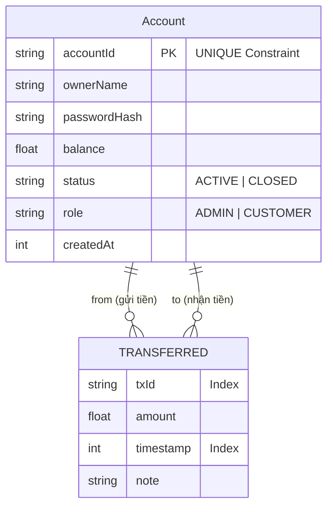
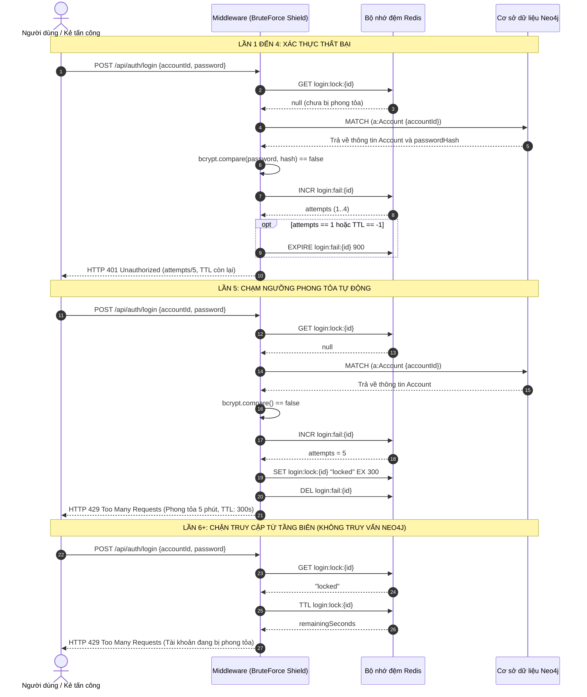
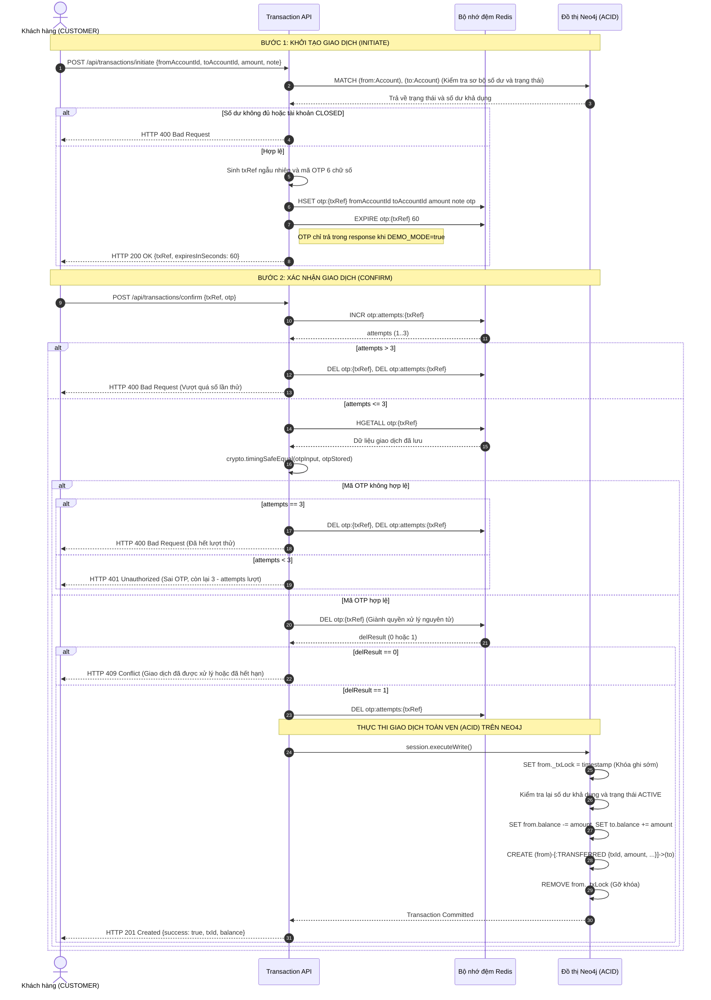

# BÁO CÁO BÀI TẬP LỚN: HỆ THỐNG PHÁT HIỆN GIAN LẬN GIAO DỊCH VÀ BẢO VỆ XÁC THỰC
**Đề tài 16: Thiết kế kiến trúc Polyglot Persistence với Neo4j và Redis**  
**Học phần: Cơ sở dữ liệu NoSQL**

## 1. Lý do chọn Polyglot Persistence (Redis + Neo4j)

Hệ thống tài chính đặt ra hai bài toán kỹ thuật đối nghịch: kiểm soát xác thực tốc độ cao với tần suất đột biến và phân tích quan hệ dòng tiền nhiều bước có độ phức tạp thuật toán cao. Không một hệ cơ sở dữ liệu NoSQL đơn lẻ nào có thể giải quyết tối ưu đồng thời cả hai bài toán:

| Tiêu chí kỹ thuật | Redis (In-Memory Key-Value) | Neo4j (Graph Database) | Hạn chế nếu chỉ dùng một CSDL duy nhất |
| :--- | :--- | :--- | :--- |
| **Mô hình dữ liệu** | Key-Value, Hash trên RAM | Labeled Property Graph (Node, Edge) | RDBMS/Redis không hỗ trợ đồ thị tự nhiên; Neo4j không tối ưu khi lưu hàng loạt trạng thái tạm thời có tần suất đọc/ghi cực cao. |
| **Độ trễ truy xuất** | Thường thấp, số đo thực tế xem mục 8 | Thường thấp, số đo thực tế xem mục 8 | Dùng Neo4j đếm lỗi đăng nhập gây tăng tải I/O đĩa; dùng Redis quét chu trình tốn kém bộ nhớ. |
| **Cơ chế TTL** | Tự hủy theo giây (`EXPIRE`, `SET EX`) | Không có trong bản Community lõi | Neo4j bản Community lõi phải dùng cơ chế quét xóa thủ công định kỳ, gây phân mảnh và cạnh tranh khóa tài nguyên. |
| **Duyệt quan hệ đa bước** | Không hỗ trợ duyệt đồ thị | Index-Free Adjacency duyệt $O(k)$ | Redis phải tải toàn bộ cạnh về tầng ứng dụng để chạy DFS/BFS, chi phí bộ nhớ và CPU tăng vọt. |

**Ba ví dụ phối hợp cụ thể trong mã nguồn:**
1. **Kiểm soát xác thực và phiên**: Khi gọi `POST /api/auth/login`, Redis kiểm tra cờ phong tỏa `login:lock:{id}` và bộ đếm lỗi `login:fail:{id}`. Nếu hợp lệ, Neo4j được truy vấn để lấy mật khẩu băm và vai trò (`role`). Khi xác thực thành công, Redis lưu token phiên dạng JSON `{accountId, role, createdAt}` trong `session:{token}`.
2. **Quy trình chuyển tiền hai bước (Initiate & Confirm)**: Bước `POST /api/transactions/initiate` ghi thông tin chờ vào Redis Hash `otp:{txRef}` (TTL 60s). Bước `POST /api/transactions/confirm` xác thực OTP trên Redis, sau đó thực thi giao dịch toàn vẹn (ACID) trên Neo4j để cập nhật số dư và tạo quan hệ `[:TRANSFERRED]`.
3. **Giám sát an ninh và quản trị**: Khi tài khoản `ADMIN` truy xuất `GET /api/auth/admin/security-status`, hệ thống quét danh sách các khóa phong tỏa `login:lock:*` và bộ đếm lỗi `login:fail:*` từ Redis bằng lệnh `SCAN` để tổng hợp số lượng tài khoản bị khóa và cảnh báo vi phạm bảo mật theo thời gian thực.

---

## 2. Mô hình đồ thị Neo4j

### 2.1. Cấu trúc Node, Relationship, Ràng buộc và Chỉ mục
- **Node `(:Account)`**:
  - `accountId` (String, UNIQUE Constraint): Mã định danh tài khoản duy nhất (VD: `ACC001`).
  - `ownerName` (String): Họ và tên chủ tài khoản.
  - `passwordHash` (String): Mật khẩu băm an toàn bằng `bcrypt`.
  - `balance` (Float/Int): Số dư khả dụng hiện tại (VNĐ).
  - `status` (String): Trạng thái tài khoản (`ACTIVE` hoặc `CLOSED`).
  - `role` (String): Vai trò người dùng (`ADMIN` hoặc `CUSTOMER`).
  - `createdAt` (Int): Unix timestamp thời điểm mở tài khoản.
  *(Chú thích: Thuộc tính tạm `_txLock` được đặt ở đầu giao dịch ACID và gỡ bỏ (`REMOVE from._txLock`) trước khi commit để chiếm khóa ghi độc quyền trên node nguồn, không phải là thuộc tính lưu trữ lâu dài của node).*
- **Relationship `[:TRANSFERRED]`**: Nối `(from:Account)-[:TRANSFERRED]->(to:Account)` gồm `txId` (String, INDEX), `amount` (Float/Int), `timestamp` (Int, INDEX), `note` (String).

```cypher
CREATE CONSTRAINT account_id_unique IF NOT EXISTS FOR (a:Account) REQUIRE a.accountId IS UNIQUE;
CREATE INDEX transferred_txid_index IF NOT EXISTS FOR ()-[r:TRANSFERRED]-() ON (r.txId);
CREATE INDEX transferred_timestamp_index IF NOT EXISTS FOR ()-[r:TRANSFERRED]-() ON (r.timestamp);
```

### 2.2. Sơ đồ thực thể đồ thị (Mermaid)



### 2.3. Truy vấn Cypher phát hiện chu trình luân chuyển khép kín 3 đỉnh

```cypher
MATCH (a:Account)-[r1:TRANSFERRED]->(b:Account)-[r2:TRANSFERRED]->(c:Account)-[r3:TRANSFERRED]->(a)
WHERE a.accountId < b.accountId
  AND a.accountId < c.accountId
  AND b.accountId <> c.accountId
  AND r1.amount >= $minAmount
  AND r2.amount >= $minAmount
  AND r3.amount >= $minAmount
WITH a, b, c, r1, r2, r3,
     (r1.amount + r2.amount + r3.amount) AS totalAmount,
     CASE
       WHEN r1.timestamp <= r2.timestamp AND r1.timestamp <= r3.timestamp THEN r1.timestamp
       WHEN r2.timestamp <= r1.timestamp AND r2.timestamp <= r3.timestamp THEN r2.timestamp
       ELSE r3.timestamp
     END AS minTime,
     CASE
       WHEN r1.timestamp >= r2.timestamp AND r1.timestamp >= r3.timestamp THEN r1.timestamp
       WHEN r2.timestamp >= r1.timestamp AND r2.timestamp >= r3.timestamp THEN r2.timestamp
       ELSE r3.timestamp
     END AS maxTime
WHERE $windowMs IS NULL OR (maxTime - minTime) <= $windowMs
RETURN a.accountId AS accA, b.accountId AS accB, c.accountId AS accC,
       r1.txId AS tx1, r2.txId AS tx2, r3.txId AS tx3,
       totalAmount, minTime, maxTime, (maxTime - minTime) AS durationMs
ORDER BY maxTime DESC;
```

**Giải thích điều kiện lọc và triệt tiêu hoán vị vòng lặp:**
- `WHERE a.accountId < b.accountId AND a.accountId < c.accountId`: Một tam giác khép kín có 3 hoán vị vòng lặp xoay chiều $(A,B,C)$, $(B,C,A)$, $(C,A,B)$. Điều kiện này cố định đỉnh xuất phát `a` có định danh từ điển nhỏ nhất, loại bỏ các bản sao do xoay vòng. Các cạnh `TRANSFERRED` song song giữa cùng một cặp tài khoản được gom theo bộ ba $(a, b, c)$ ở tầng ứng dụng bằng cấu trúc `tripletMap` (`Map` kết hợp `Set` định danh giao dịch trong `src/routes/fraud.js`).
- `AND b.accountId <> c.accountId`: Loại bỏ trường hợp thoái hóa hai đỉnh chuyển tiền qua lại.
- `AND r1.amount >= $minAmount ...`: Lọc các giao dịch có giá trị vượt ngưỡng nghi vấn.
- `WHERE $windowMs IS NULL OR (maxTime - minTime) <= $windowMs`: Ràng buộc toàn bộ 3 giao dịch phải hoàn tất trong cửa sổ thời gian trượt ($windowMs$).

---

## 3. Bảng thiết kế cấu trúc Key-Value trên Redis

| Khóa Redis (Key Pattern) | Kiểu dữ liệu | Cấu trúc giá trị (Value) | TTL | Lệnh sử dụng chính | Mục đích nghiệp vụ |
| :--- | :--- | :--- | :--- | :--- | :--- |
| `session:{token}` | String | JSON `{"accountId": "ACC...", "role": "ADMIN\|CUSTOMER", "createdAt": 172...}` | Biến môi trường `SESSION_TTL_SECONDS` (mặc định 3.600s / 1h) | `SET ... EX 3600`, `GET`, `EXPIRE`, `DEL` | Lưu trữ phiên đăng nhập và phân quyền người dùng; Middleware `requireRole` kiểm tra quyền tức thời trên RAM mà không cần truy vấn Neo4j. |
| `login:fail:{accountId}` | String (Integer) | Số nguyên biểu diễn số lần xác thực thất bại liên tiếp (`1`..`4`) | 900s (15p, `FAIL_WINDOW`) | `INCR`, `EXPIRE 900`, `TTL`, `DEL` | Cửa sổ trượt đếm số lần đăng nhập sai mật khẩu; tự kích hoạt TTL khi khởi tạo; xóa ngay khi đăng nhập đúng hoặc khi tài khoản chuyển sang trạng thái phong tỏa. |
| `login:lock:{accountId}` | String | Chuỗi `"locked"` | 300s (5p, `LOCK_DURATION`) | `SET ... EX 300`, `GET`, `TTL`, `DEL` | Cờ phong tỏa tài khoản khi xác thực thất bại liên tiếp 5 lần; Middleware chặn ngay từ tầng biên với mã HTTP 429, bảo vệ tầng CSDL Neo4j trước tấn công vét cạn. |
| `otp:{txRef}` | Hash | Các trường: `fromAccountId`, `toAccountId`, `amount`, `note`, `otp` | 60s (1p) | `HSET`, `HGETALL`, `EXPIRE 60`, `DEL` | Lưu trữ trạng thái tạm thời của giao dịch chờ xác thực; xóa nguyên tử (`DEL == 1`) khi bước xác nhận thành công nhằm chống tấn công phát lại (Replay Attack). |
| `otp:attempts:{txRef}` | String (Integer) | Số nguyên biểu diễn số lần thử mã OTP (`1`..`3`) | 60s (1p) | `INCR`, `EXPIRE 60`, `DEL` | Kiểm soát giới hạn tối đa 3 lần xác thực OTP; tự động hủy bỏ giao dịch chờ và bộ đếm nếu nhập sai quá 3 lần liên tiếp. |

---

## 4. Sơ đồ tuần tự tương tác hệ thống

### 4.1. Luồng xác thực thất bại 5 lần dẫn tới phong tỏa tài khoản (HTTP 429)



### 4.2. Luồng giao dịch chuyển tiền hai bước kèm xác thực OTP (Initiate & Confirm)



---

## 5. Đảm bảo tính toàn vẹn dữ liệu qua giao dịch toàn vẹn (ACID)

Trong nghiệp vụ chuyển khoản ngân hàng, một giao dịch hoàn chỉnh giữa hai tài khoản bắt buộc bao gồm ba thao tác cấu thành:
1. Giảm số dư tài khoản người gửi: `from.balance = from.balance - amount`.
2. Tăng số dư tài khoản người nhận: `to.balance = to.balance + amount`.
3. Tạo mới cạnh quan hệ trong đồ thị: `(from)-[:TRANSFERRED]->(to)`.

Nếu không đảm bảo tính nguyên tử (Atomicity) và cô lập (Isolation) của giao dịch toàn vẹn (ACID), bất kỳ sự cố mạng hoặc lỗi runtime nào xảy ra giữa chừng đều dẫn đến sai lệch nghiêm trọng: người chuyển bị trừ tiền nhưng người nhận chưa được ghi có, hoặc tiền đã chuyển nhưng không lưu vết quan hệ để kiểm toán và quét chu trình.

Hệ thống sử dụng cơ chế quản trị giao dịch ghi của Neo4j (`session.executeWrite`). Phương thức `executeWrite` của `neo4j-driver` tự thử lại các lỗi tạm thời (transient), kể cả khi Neo4j phát hiện bế tắc (deadlock). Khi bắt đầu phiên, câu lệnh thực thi ghi sớm `SET from._txLock = $timestamp`, lập tức kích hoạt khóa ghi độc quyền (Exclusive Write Lock) trên node nguồn `from`. Cơ chế này ngăn chặn nguy cơ chi tiêu vượt mức (Double Spending) khi phát sinh nhiều yêu cầu rút tiền đồng thời. Mọi giao dịch cạnh tranh buộc phải xếp hàng chờ giao dịch đầu tiên hoàn tất. Sau khi kiểm tra lại số dư và trạng thái tài khoản, cập nhật số dư hai bên và tạo cạnh giao dịch, thuộc tính tạm này được gỡ bỏ bằng `REMOVE from._txLock` trước khi commit. Mọi lỗi phát sinh đều kích hoạt rollback tự động toàn bộ thao tác về trạng thái ban đầu.

---

## 6. Phân công nhiệm vụ nhóm sinh viên (2 thành viên)

| Thành viên | Vai trò phụ trách | Hạng mục công việc kỹ thuật chi tiết |
| :--- | :--- | :--- |
| **Sinh viên 1** | Data Architect & Backend Lead (gộp SV1 của đề và phần nạp dữ liệu của SV3) | - Thiết kế đồ thị tài khoản và luồng chuyển tiền trên Neo4j (node, cạnh, constraint, index).<br>- Thiết kế cấu trúc key bảo mật trên Redis (`session`, `login:fail`, `login:lock`, `otp:{txRef}`, `otp:attempts:{txRef}`).<br>- Viết API chuyển khoản hai bước (`initiate`, `confirm`) và giao dịch toàn vẹn (ACID).<br>- Lập trình các API CRUD tài khoản và cổng khách hàng.<br>- Nạp 50 tài khoản và chuỗi giao dịch giả lập vào Neo4j (`seed.js`).<br>- Đo kiểm benchmark phía Neo4j (Cypher có/không index). |
| **Sinh viên 2** | Security & Integration Lead (gộp SV2 của đề và phần còn lại của SV3) | - Lập trình Middleware chống Brute-force trên Redis (`INCR` + `EXPIRE`, khóa 5 phút sau 5 lần sai) và phân quyền `requireRole`.<br>- Viết câu lệnh Cypher quét chu trình dòng tiền khép kín trên Neo4j.<br>- Thiết lập dữ liệu mẫu Redis cho ít nhất 10 tài khoản và quản trị key bằng Redis Insight.<br>- Thiết kế Dashboard Admin cảnh báo gian lận.<br>- Điều phối kịch bản demo.<br>- Đo kiểm benchmark phía Redis và HTTP, bộ kiểm thử tự động. |

### Đóng góp bổ sung của cả 2 thành viên
Các tính năng nâng cao bao gồm: xác thực giao dịch qua mã OTP hai bước, hệ thống phân quyền vai trò người dùng (`ADMIN` và `CUSTOMER`), bộ công cụ đo lường hiệu năng tự động (benchmark), cùng tài liệu báo cáo kỹ thuật là công việc chung của cả 2 thành viên trong nhóm.

### Phân bổ trình bày demo
- **Sinh viên 1**: Phụ trách kịch bản chuyển tiền (chu trình ACC030→ACC031→ACC032→ACC030 và giao dịch có OTP).
- **Sinh viên 2**: Phụ trách kịch bản chống brute-force và quét đồ thị chu trình.

---

## 7. Dữ liệu mẫu và kết quả kiểm thử

### 7.1. Hiện trạng dữ liệu khởi tạo từ `seed.js`
- **Tài khoản Neo4j**: Đúng 50 node `(:Account)` định danh từ `ACC001` đến `ACC050`, trạng thái ban đầu đều là `ACTIVE` (trong đó `ACC001` có vai trò `ADMIN`, các tài khoản còn lại là `CUSTOMER`). Bổ sung 3 node `(:Staff)` nhân sự gồm 1 `ADMIN` (`STAFF001`) và 2 `ANALYST` (`STAFF002`, `STAFF003`).
- **Giao dịch Neo4j**: Tổng cộng 114 quan hệ `[:TRANSFERRED]` (9 giao dịch thuộc 3 chu trình cài sẵn + 105 giao dịch DAG hợp lệ).
- **3 chu trình luân chuyển khép kín cài sẵn trong Neo4j**:
  1. `ACC001` $\to$ `ACC002` $\to$ `ACC003` $\to$ `ACC001` (Tổng luân chuyển: 148.500.000 VNĐ).
  2. `ACC004` $\to$ `ACC005` $\to$ `ACC006` $\to$ `ACC004` (Tổng luân chuyển: 237.500.000 VNĐ).
  3. `ACC007` $\to$ `ACC008` $\to$ `ACC009` $\to$ `ACC007` (Tổng luân chuyển: 355.500.000 VNĐ).
- **Tài khoản trên Redis**: Khởi tạo sẵn 12 tài khoản mô phỏng:
  - 3 tài khoản đang bị phong tỏa: `ACC010`, `ACC011`, `ACC012` với key `login:lock:{id}` (TTL 300s).
  - 9 tài khoản đang có bộ đếm lỗi: `ACC013`..`ACC021` với key `login:fail:{id}` từ 1 đến 4 lần thử (TTL 3.600s).

### 7.2. Đối chiếu yêu cầu của đề và phương thức chứng minh khi Demo

| Yêu cầu của đề bài | Tiêu chí kỹ thuật | Cách chứng minh khi Demo thực tế |
| :--- | :--- | :--- |
| **INCR + EXPIRE trên Redis** | Bộ đếm lỗi trượt 900s | Gửi request đăng nhập sai từ 1 đến 4 lần; kiểm tra trên Redis Insight thấy key `login:fail:{id}` tăng dần từ 1 đến 4 và có TTL đếm ngược. |
| **Khóa 5 phút sau 5 lần sai** | Phong tỏa tự động | Đăng nhập sai lần thứ 5; Redis tự tạo key `login:lock:{id}` có TTL 300s và xóa key fail; API trả mã HTTP 429 kèm số giây chờ. |
| **Cypher quét chu trình** | Phát hiện vòng xoay tiền | Nhấn nút "Rà soát chu trình nghi vấn" trên Dashboard Admin; Cypher trả về chính xác 3 chu trình cài sẵn và vẽ trực quan đồ thị mạng lưới. |
| **Quy mô $\ge 50$ node Account** | Số lượng node tài khoản | Kiểm tra đồ thị hoặc chạy `MATCH (a:Account) RETURN count(a)` hiển thị đủ 50 tài khoản khách hàng. |
| **Quy mô $\ge 100$ giao dịch** | Số lượng quan hệ chuyển tiền | Truy vấn `MATCH ()-[r:TRANSFERRED]->() RETURN count(r)` xác nhận đủ 114 giao dịch. |
| **Quy mô $\ge 10$ tài khoản Redis** | Trạng thái bảo mật trên RAM | Kiểm tra trên Redis Insight hiển thị 12 tài khoản (3 tài khoản bị khóa và 9 tài khoản có lỗi). |

### 7.3. Kết quả chạy bộ kiểm thử tự động (Automated Test Suite)
Bộ kiểm thử Jest toàn diện (`npm test`) thực thi trên 7 bộ kiểm thử chuyên biệt với kết quả nghiệm thu:
- **Test Suites**: `7 passed, 7 total` (`auth.test.js`, `sessions.test.js`, `fraud.test.js`, `accounts.test.js`, `risk.test.js`, `events.test.js`, `transactions.test.js`).
- **Tests**: `23 passed, 23 total (100% PASS)`.
- **Nội dung kiểm định**: Xác thực tài khoản, kiểm soát phiên và tự hủy phiên khi khóa, chống brute-force và phong tỏa 429 sau 5 lần sai, phát hiện chu trình dòng tiền khép kín 3 đỉnh, giao dịch chuyển tiền 2 bước với mã OTP và cơ chế khóa ghi `_txLock` (ACID).

---

## 8. Kết quả kiểm thử hiệu năng (Trích xuất từ docs/BENCHMARK.md)

Hệ thống tích hợp bộ công cụ đo lường hiệu năng tự động tại `scripts/benchmark.js`, cho phép đánh giá định lượng các chỉ số thời gian phản hồi: Trung bình (Avg), Trung vị (P50), Phân vị 95 (P95) và Phân vị 99 (P99).

Các số liệu được nghiệm thu thực tế trên môi trường phân tán điện toán đám mây (Neo4j Aura 5.27 và Upstash Redis 8.4 tại vùng `ap-southeast-1`, độ trễ PING trung bình 53.06 ms) với cờ bảo mật `STRICT_DB=true`:

| Hạng mục kiểm thử | Tập dữ liệu / Thao tác đo lường | Số mẫu | Avg (ms) | P50 (ms) | P95 (ms) | P99 (ms) | Trạng thái Nghiệm thu |
| :--- | :--- | :---: | :---: | :---: | :---: | :---: | :---: |
| **Độ trễ Redis INCR + EXPIRE** | Thao tác trên key `login:fail:{id}` | 10.000 | 51.76 | 50.97 | 54.62 | 81.66 | Đã nghiệm thu (Upstash) |
| **Độ trễ HTTP API Login** | POST `/api/auth/login` (Sai pass, bcrypt + Redis) | 200 | 100.12 | 82.84 | 95.61 | 675.17 | Đã nghiệm thu (3000) |
| **Cypher Quét chu trình (CÓ Index)** | Đồ thị 1.000 Account / 10.000 Transferred | 20 | 159.87 | 127.13 | 657.21 | 657.21 | Đã nghiệm thu (Neo4j Aura) |
| **Cypher Quét chu trình (KHÔNG Index)** | Đồ thị 1.000 Account / 10.000 Transferred | 20 | 126.07 | 120.02 | 272.04 | 272.04 | Đã nghiệm thu (Neo4j Aura) |

Kết quả đo chứng minh tầng đệm Redis và cấu trúc Cypher trên Neo4j vận hành ổn định, độ trễ đáp ứng tốt cho giao dịch trực tuyến thời gian thực. Chi tiết phân phối thời gian và thông lượng phép tính được lưu vết tại tệp `docs/BENCHMARK.md`.

---

## 9. Giới hạn của mô phỏng hệ thống

Hệ thống được thiết kế dưới dạng ứng dụng minh họa học thuật cho đề tài NoSQL, do đó có một số giới hạn kỹ thuật:
1. **Lưu trữ và phân phối mã OTP**: Khi bật biến môi trường `DEMO_MODE=true`, mã OTP được trả về trực tiếp trong phản hồi API nhằm mục đích mô phỏng tin nhắn SMS để tiện thử nghiệm. Mã OTP được lưu dưới dạng bản rõ trong Redis Hash `otp:{txRef}`. Hệ thống sản xuất thực tế tuyệt đối không được làm như vậy, mà phải băm an toàn mã OTP và phân phối qua kênh bảo mật ngoài băng (Out-Of-Band) như SMS Gateway, Email hoặc ứng dụng TOTP.
2. **Quy trình định danh khách hàng (KYC)**: Thông tin tài khoản được khởi tạo mô phỏng qua kịch bản mẫu (`seed.js`), chưa tích hợp xác minh danh tính điện tử (eKYC) hoặc dấu vân tay thiết bị để phát hiện phiên truy cập bất thường.
3. **Tiền tệ và kết nối liên ngân hàng**: Số dư và dòng tiền hoàn toàn là số liệu mô phỏng trong không gian đồ thị Neo4j, không kết nối với hệ thống ngân hàng lõi (Core Banking) hoặc mạng lưới thanh toán liên ngân hàng thực tế (NAPAS, SWIFT).

---

## 10. Kết luận

Dự án hoàn thiện kiến trúc Polyglot Persistence (Redis + Neo4j) với 3 kết quả chính: (1) Chống tấn công vét cạn mật khẩu hiệu quả qua cửa sổ trượt INCR + EXPIRE và phong tỏa tự động; (2) Ngăn chặn chi tiêu vượt mức (Double Spending) và đảm bảo toàn vẹn bằng giao dịch ACID có khóa ghi sớm `_txLock`; (3) Quét và phát hiện chính xác các chu trình luân chuyển khép kín trên đồ thị. Hai hướng phát triển tiếp theo gồm: áp dụng băm bảo mật HMAC cho mã OTP trên Redis và tự động phong tỏa tài khoản tức thời khi Neo4j phát hiện chu trình nghi vấn.
