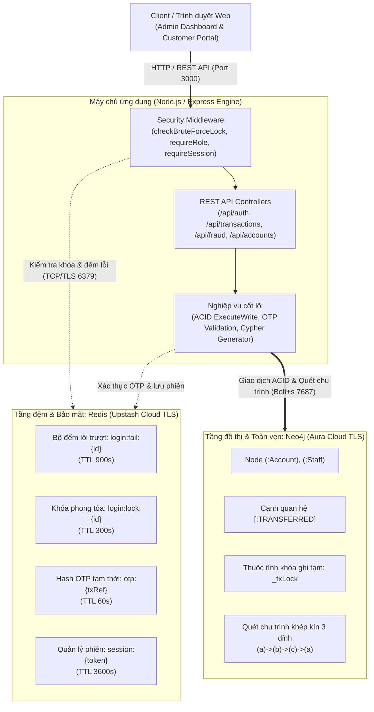

# TÀI LIỆU ĐẶC TẢ YÊU CẦU PHẦN MỀM (SOFTWARE REQUIREMENTS SPECIFICATION - SRS)
## Đề tài 16 – Phát hiện gian lận giao dịch và chống tấn công Brute-force
**Áp dụng khung chuẩn ISO/IEC/IEEE 29148:2018 và mô hình chất lượng ISO/IEC 25010**

---

### THÔNG TIN HỒ SƠ DỰ ÁN

* **Đơn vị đào tạo**: BỘ CÔNG THƯƠNG — TRƯỜNG ĐẠI HỌC CÔNG THƯƠNG TP. HỒ CHÍ MINH (HUIT)
* **Khoa / Bộ môn**: KHOA CÔNG NGHỆ THÔNG TIN — BỘ MÔN HỆ THỐNG THÔNG TIN
* **Tên dự án**: Hệ thống phát hiện gian lận giao dịch tài chính (Neo4j) và phòng chống tấn công dò quét mật khẩu Brute-force (Redis) — FinGuard Pro
* **Mã đề tài**: Đề tài 16 (Nhóm 14 – Học phần: Cơ sở dữ liệu NoSQL / Hệ quản trị CSDL Hiện đại)
* **Phiên bản tài liệu**: 1.0 (Nghiệm thu chính thức trên Neo4j Aura & Upstash Redis)
* **Ngày phát hành**: 28/10/2026
* **Giảng viên hướng dẫn**: ThS. Trần Quang Bình
* **Nhóm sinh viên thực hiện (Nhóm 14 – 2 thành viên)**:
  1. **Sinh viên 1**: Nguyễn Quang Đức – MSSV: 2001230195 – *Vai trò: Data Architect & Backend Lead (Nhóm trưởng)*
  2. **Sinh viên 2**: Chu Đức Vân – MSSV: 2001231028 – *Vai trò: Security & Integration Lead*

#### Lịch sử sửa đổi tài liệu

| Phiên bản | Ngày | Tác giả | Tóm tắt nội dung thay đổi |
| :---: | :---: | :---: | :--- |
| **0.1** | 15/10/2026 | Nhóm SV | Khởi tạo cấu trúc SRS ban đầu theo khung ISO/IEC/IEEE 29148:2018. |
| **0.5** | 20/10/2026 | Nguyễn Quang Đức | Bổ sung đặc tả mô hình đồ thị Neo4j, giao dịch toàn vẹn (ACID) và API nghiệp vụ. |
| **0.9** | 25/10/2026 | Chu Đức Vân | Bổ sung đặc tả bảo mật Redis, chống Brute-force, OTP 2 bước và yêu cầu phi chức năng. |
| **1.0** | 28/10/2026 | Cả nhóm | Hoàn thiện ma trận truy vết, trích xuất dữ liệu nghiệm thu hiệu năng thực tế. |

---

## 1. Giới thiệu (Introduction)

### 1.1. Mục đích tài liệu
Tài liệu này đặc tả chi tiết toàn bộ các yêu cầu chức năng (Functional Requirements), yêu cầu phi chức năng (Non-Functional Requirements), thiết kế giao diện bên ngoài, mô hình dữ liệu và ràng buộc kỹ thuật của hệ thống. Tài liệu được biên soạn phục vụ công tác phát triển, kiểm thử tự động, nghiệm thu kỹ thuật và đối chiếu bảo vệ đồ án trước Hội đồng chấm thi.

### 1.2. Phạm vi sản phẩm (Scope)
* **Trong phạm vi (In-Scope)**:
  * Xây dựng kiến trúc lưu trữ đa mô hình Polyglot Persistence kết hợp giữa CSDL Key-Value tốc độ cao trong bộ nhớ (Redis / Upstash Cloud TLS) và CSDL Đồ thị quan hệ phức tạp (Neo4j / Neo4j Aura Cloud).
  * Phòng chống tấn công dò quét mật khẩu (Brute-force / Dictionary Attack) theo cơ chế cửa sổ trượt `INCR` + `EXPIRE` và phong tỏa tài khoản tự động (HTTP 429) ở tầng biên.
  * Nhận diện và cảnh báo sớm các hành vi rửa tiền luân chuyển khép kín (Circular Fraud Cycles) trên mạng lưới giao dịch bằng truy vấn Cypher tối ưu hóa chỉ mục.
  * Thực thi giao dịch chuyển tiền hai bước kèm mã xác thực OTP (Initiate & Confirm) với cơ chế khóa ghi tạm thời đảm bảo tính toàn vẹn (ACID) tuyệt đối trên đồ thị.
  * Cung cấp Dashboard Quản trị viên (Admin Dashboard) giám sát trực quan hóa đồ thị thời gian thực và quản lý tài khoản.
* **Ngoài phạm vi (Out-of-Scope)**:
  * Quy trình định danh điện tử khách hàng thực tế (eKYC / đối soát giấy tờ tùy thân).
  * Tích hợp dịch vụ tin nhắn viễn thông SMS Gateway hoặc Email ngoài băng (Out-Of-Band) thật (mã OTP được trả qua phản hồi API khi bật cờ mô phỏng `DEMO_MODE=true`).
  * Kết nối trực tiếp vào hạ tầng ngân hàng lõi (Core Banking) hoặc mạng lưới thanh toán bù trừ liên ngân hàng quốc gia/quốc tế (NAPAS, SWIFT).

### 1.3. Thuật ngữ và viết tắt

| Thuật ngữ / Viết tắt | Định nghĩa chi tiết |
| :--- | :--- |
| **ACID** | Atomicity, Consistency, Isolation, Durability – Bốn thuộc tính bảo đảm tính toàn vẹn của giao dịch CSDL. |
| **Brute-force Attack** | Tấn công vét cạn mật khẩu bằng cách thử nhiều tổ hợp thông tin xác thực liên tiếp. |
| **Cypher** | Ngôn ngữ truy vấn khai báo (Declarative Graph Query Language) chuẩn dành cho CSDL Đồ thị Neo4j. |
| **Polyglot Persistence** | Kiến trúc sử dụng nhiều loại CSDL NoSQL song song nhằm tối ưu hóa cho từng mô hình dữ liệu đặc thù. |
| **TTL** | Time-To-Live – Thời gian tồn tại tự hủy của khóa (Key) được định cấu hình trên bộ nhớ Redis. |
| **OTP** | One-Time Password – Mật khẩu xác thực sử dụng một lần có thời hạn hiệu lực ngắn. |
| **vis-network** | Thư viện đồ họa JavaScript hỗ trợ trực quan hóa các mạng lưới đồ thị tương tác phía Client. |

### 1.4. Tài liệu tham chiếu
1. Chuẩn quốc tế **ISO/IEC/IEEE 29148:2018**: *Systems and software engineering — Life cycle processes — Requirements engineering*.
2. Chuẩn quốc tế **ISO/IEC 25010**: *Systems and software quality models* (ghi chú: bao gồm cấu trúc cập nhật theo bản sửa đổi 2023).
3. Bản mô tả yêu cầu đề tài: *Đề tài 16 – Phát hiện gian lận giao dịch (Neo4j) và chống tấn công Brute-force (Redis)*.
4. Báo cáo kiến trúc kỹ thuật nội bộ: `docs/BAO_CAO.md`.
5. Báo cáo đo lường hiệu năng: `docs/BENCHMARK.md`.
6. Kịch bản chạy trình diễn nghiệm thu: `DEMO.md`.

---

## 2. Mô tả tổng quan (Overall Description)

### 2.1. Góc nhìn sản phẩm (Product Perspective)
Hệ thống vận hành theo mô hình kiến trúc phân tầng Polyglot Persistence hiện đại:



### 2.2. Nhóm người dùng (User Classes and Characteristics)
1. **Khách hàng (CUSTOMER)**:
   * Người dùng dịch vụ ngân hàng trực tuyến.
   * Quyền hạn: Đăng nhập tài khoản cá nhân, xem số dư và lịch sử giao dịch cá nhân (`/api/me/*`), khởi tạo giao dịch chuyển tiền 2 bước và xác nhận mã OTP của chính mình.
2. **Quản trị viên hệ thống (ADMIN)**:
   * Kỹ sư quản trị hệ thống và kiểm soát an toàn thông tin.
   * Quyền hạn: Toàn quyền truy cập mọi tính năng; giám sát đồ thị dòng tiền; quét chu trình gian lận; quản lý tài khoản (CRUD); mở khóa tài khoản bị khóa brute-force; gỡ chặn IP; cấu hình chế độ bảo mật (`ALERT` / `BLOCK`); nạp lại dữ liệu mẫu (`seed-reset`).
3. **Chuyên viên phân tích (ANALYST)**:
   * Nhân sự nghiệp vụ phân tích rủi ro và phòng chống rửa tiền.
   * Quyền hạn: Xem đồ thị, quét chu trình gian lận độ dài biến đổi (3–5 đỉnh), phân tích 3 mẫu gian lận chuyên sâu (Structuring, Passthrough, Fanout), theo dõi Stream sự kiện bảo mật và điểm rủi ro tài khoản.

### 2.3. Ràng buộc thiết kế và triển khai (Design Constraints)
* **Hạn mức tài nguyên Redis Upstash**: Gói dịch vụ miễn phí (Free Tier) giới hạn dung lượng lưu trữ tối đa 256 MB và hạn mức 500.000 lệnh thực thi/tháng. Bắt buộc tối ưu số lượng lệnh gửi đi thông qua `SCAN` phân trang, lệnh `MGET` gom khối và Redis `Pipeline`.
* **Môi trường kết nối Neo4j Aura**: CSDL đồ thị đám mây Neo4j Aura áp dụng kết nối bắt buộc mã hóa qua giao thức `neo4j+s://`, thời gian bắt tay kết nối (Connection Handshake) qua mạng WAN quốc tế dao động từ 50ms – 100ms.
* **Cờ bắt buộc cơ sở dữ liệu thật (`STRICT_DB=true`)**: Khi bật cờ này trong cấu hình môi trường, hệ thống tuyệt đối không được phép sử dụng bộ giả lập trong bộ nhớ RAM (In-Memory Fallback); nếu mất kết nối CSDL thật, tiến trình phải dừng ngay lập tức kèm thông báo lỗi rõ ràng.

### 2.4. Giả định và phụ thuộc (Assumptions and Dependencies)
* Máy chủ triển khai cài đặt môi trường thực thi Node.js phiên bản tối thiểu `>= 18.0.0`.
* Trình duyệt của người dùng hỗ trợ chuẩn JavaScript ES6+, hỗ trợ hiển thị đồ họa SVG/Canvas phục vụ thư viện `vis-network`.

---

## 3. Giao diện bên ngoài (External Interface Requirements)

### 3.1. Giao diện người dùng (User Interfaces)
Hệ thống cung cấp 3 không gian giao diện Web độc lập (chứa trong thư mục `public/`):
1. **Trang đăng nhập tập trung (`public/login.html`)**: Cho phép chọn vai trò Khách hàng hoặc Nhân viên, có cơ chế phản hồi trực quan số lần thử còn lại và thời gian đếm ngược phong tỏa khi bị lỗi 429.
2. **Dashboard Quản trị viên (`public/index.html`)**: Trung tâm giám sát hợp nhất gồm các phân hệ:
   * *Tab Giám sát tổng quan*: Trực quan hóa đồ thị `vis-network`, tô màu đỏ các đỉnh và cạnh nằm trong chu trình gian lận, bảng thống kê chu trình kèm nút phóng to (`Zoom`).
   * *Tab Chuyển tiền & Demo*: Giao diện mô phỏng chuyển tiền 2 bước kèm nhập OTP và form thử nghiệm dò mật khẩu.
   * *Tab Quản lý tài khoản*: Danh sách 50 tài khoản, thao tác Thêm / Sửa / Khóa / Mở tài khoản.
   * *Tab Bảo mật & Brute-Force*: Giám sát trạng thái các key Redis thời gian thực, bảng IP nghi vấn, tính năng mở khóa tức thời và thu hồi phiên.
   * *Tab Phân tích sâu & Giải thích*: Quét chu trình 3–5 đỉnh, phân tích 3 mẫu gian lận nâng cao và trực quan hóa cây thực thi `PROFILE` Cypher.
3. **Cổng giao dịch Khách hàng (`public/app/index.html`)**: Giao diện cá nhân hóa cho Khách hàng xem số dư, tra cứu lịch sử nhận/chuyển tiền và thực hiện chuyển khoản an toàn.

### 3.2. Giao diện phần mềm (Software REST API Interfaces)
Toàn bộ danh mục Endpoint REST của hệ thống được trích xuất trực tiếp từ mã nguồn `src/routes/*.js` và `src/server.js`:

| Phương thức | Đường dẫn Endpoint | Quyền / Vai trò | Mã HTTP trả về | Tóm tắt nghiệp vụ kỹ thuật |
| :---: | :--- | :---: | :---: | :--- |
| **GET** | `/api/health` | Public | 200 | Kiểm tra trạng thái Neo4j và Redis (`"real"` hoặc `"fallback"`). |
| **POST** | `/api/auth/login` | Public | 200, 400, 401, 403, 429, 500 | Đăng nhập tài khoản khách hàng, áp dụng bộ đếm Brute-force Redis. |
| **GET** | `/api/auth/me` | Đã đăng nhập | 200, 401, 404, 500 | Lấy thông tin tài khoản và thông tin phiên hiện tại. |
| **POST** | `/api/auth/logout` | Đã đăng nhập | 200, 401, 500 | Đăng xuất và xóa phiên `session:{token}` trong Redis. |
| **GET** | `/api/auth/admin/security-status` | `ADMIN` | 200, 401, 403, 500 | Lấy danh sách tài khoản có bộ đếm lỗi hoặc đang bị khóa kèm TTL. |
| **POST** | `/api/auth/admin/unlock/:accountId` | `ADMIN` | 200, 401, 403, 500 | Mở khóa cưỡng bức và xóa bộ đếm lỗi cho tài khoản trên Redis. |
| **GET** | `/api/auth/admin/ip-status` | `ADMIN`, `ANALYST` | 200, 401, 403, 500 | Xem danh sách IP đang có bộ đếm dò quét hoặc đang bị chặn. |
| **POST** | `/api/auth/admin/ip-unblock/:ip` | `ADMIN` | 200, 401, 403, 500 | Gỡ chặn và xóa bộ đếm cho địa chỉ IP trên Redis. |
| **GET** | `/api/auth/admin/sessions` | `ADMIN`, `ANALYST` | 200, 401, 403, 500 | Xem danh sách các phiên hoạt động (chỉ hiển thị 8 ký tự đầu token). |
| **POST** | `/api/auth/admin/sessions/revoke` | `ADMIN` | 200, 400, 401, 403, 500 | Thu hồi phiên theo `sessionId` hoặc thu hồi tất cả phiên của `accountId`. |
| **POST** | `/api/staff/login` | Public | 200, 400, 401, 403, 429, 500 | Đăng nhập dành riêng cho nhân viên (`ADMIN` / `ANALYST`). |
| **GET** | `/api/staff/me` | `ADMIN`, `ANALYST` | 200, 401, 404, 500 | Lấy thông tin hồ sơ nhân sự đang đăng nhập. |
| **POST** | `/api/staff/logout` | Đã đăng nhập | 200, 401, 500 | Đăng xuất nhân viên và xóa cookie phiên làm việc. |
| **GET** | `/api/staff/audit` | `ADMIN` | 200, 401, 403, 500 | Xem nhật ký thao tác ghi của nhân viên từ Redis Stream `audit:log`. |
| **GET** | `/api/me/account` | `CUSTOMER`, `ADMIN` | 200, 401, 404, 500 | Khách hàng tra cứu thông tin số dư (ẩn mã băm mật khẩu). |
| **GET** | `/api/me/transactions` | `CUSTOMER`, `ADMIN` | 200, 401, 500 | Khách hàng tra cứu lịch sử biến động số dư cá nhân. |
| **GET** | `/api/accounts` | `ADMIN` | 200, 401, 403, 500 | Xem danh mục toàn bộ tài khoản trong hệ thống. |
| **GET** | `/api/accounts/:accountId` | `ADMIN`, `CUSTOMER` | 200, 401, 404, 500 | Xem thông tin chi tiết một tài khoản xác định. |
| **POST** | `/api/accounts` | `ADMIN` | 201, 400, 401, 403, 409, 500 | Tạo mới tài khoản khách hàng vào Neo4j (băm bcrypt mật khẩu). |
| **PUT** | `/api/accounts/:accountId` | `ADMIN` | 200, 400, 401, 403, 404, 500 | Cập nhật thông tin tài khoản (nếu đóng thì tự hủy các phiên đăng nhập). |
| **DELETE**| `/api/accounts/:accountId` | `ADMIN` | 200, 401, 403, 404, 500 | Đóng tài khoản (Soft Delete) hoặc xóa vĩnh viễn (Hard Delete). |
| **GET** | `/api/accounts/:accountId/transactions` | `ADMIN`, `CUSTOMER` | 200, 401, 500 | Xem lịch sử giao dịch phát sinh của một tài khoản. |
| **POST** | `/api/transactions/initiate`| `CUSTOMER`, `ADMIN` | 200, 400, 401, 403, 404, 423, 500| Bước 1: Khởi tạo chuyển tiền, sinh OTP 6 số lưu Redis (TTL 60s). |
| **POST** | `/api/transactions/confirm` | `CUSTOMER`, `ADMIN` | 201, 400, 401, 403, 409, 500 | Bước 2: Xác thực OTP, xóa nguyên tử OTP và thực thi ghi ACID Neo4j. |
| **POST** | `/api/transactions` | Đã đăng nhập | 201, 400, 401, 403, 404, 409, 423, 500 | Thực thi giao dịch chuyển tiền trực tiếp (ACID write transaction). |
| **GET** | `/api/transactions` | Public | 200, 500 | Lấy danh sách các giao dịch phát sinh gần nhất trên toàn hệ thống. |
| **GET** | `/api/fraud/cycles` | Public | 200, 500 | Quét chu trình 3 đỉnh `(a)->(b)->(c)->(a)` và trả dữ liệu vis-network. |
| **GET** | `/api/fraud/cycles/long` | `ADMIN`, `ANALYST` | 200, 400, 401, 403, 500, 504 | Quét chu trình độ dài biến đổi từ 3 đến 5 đỉnh khép kín. |
| **GET** | `/api/fraud/patterns` | `ADMIN`, `ANALYST` | 200, 400, 401, 403, 500, 504 | Phát hiện 3 mẫu gian lận (Structuring, Passthrough, Fanout). |
| **GET** | `/api/fraud/explain` | `ADMIN`, `ANALYST` | 200, 400, 401, 403, 500 | Chạy `PROFILE` Cypher và trả về các toán tử trong cây kế hoạch truy vấn. |
| **GET** | `/api/security/mode` | `ADMIN`, `ANALYST` | 200, 401, 403, 500 | Lấy chế độ chống gian lận hiện hành (`ALERT` hoặc `BLOCK`). |
| **PUT** | `/api/security/mode` | `ADMIN` | 200, 400, 401, 403, 500 | Điều chỉnh chế độ chống gian lận (`ALERT` hoặc `BLOCK`). |
| **GET** | `/api/security/frozen` | `ADMIN`, `ANALYST` | 200, 401, 403, 500 | Xem danh sách các tài khoản đang bị đóng băng bởi Redis. |
| **POST** | `/api/security/unfreeze/:id`| `ADMIN` | 200, 400, 401, 403, 500 | Gỡ đóng băng thủ công cho tài khoản trên Redis. |
| **GET** | `/api/risk/scores` | `ADMIN`, `ANALYST` | 200, 401, 403, 500 | Tính toán chỉ số rủi ro tổng hợp từ Neo4j và Redis Pipeline. |
| **GET** | `/api/events` | `ADMIN`, `ANALYST` | 200, 401, 403, 500, 503 | Lấy danh sách sự kiện an ninh từ Redis Stream `security:events`. |
| **GET** | `/api/events/stream` | `ADMIN`, `ANALYST` | 200 (SSE), 401, 403, 503 | Server-Sent Events phát sự kiện an ninh thời gian thực. |
| **POST** | `/api/demo/attack` | `ADMIN`, `ANALYST` | 200, 400, 401, 403 | Mô phỏng tấn công vét cạn từ điển (Dictionary Attack Simulation). |
| **POST** | `/api/admin/seed-reset` | `ADMIN` | 200, 401, 403, 500 | Xóa sạch và nạp lại toàn bộ dữ liệu mẫu ban đầu. |
| **POST** | `/api/admin/seed-patterns`| `ADMIN` | 200, 401, 403, 500 | Nạp dữ liệu mẫu 15 giao dịch phục vụ demo 3 mẫu gian lận nâng cao. |

### 3.3. Giao diện truyền thông (Communications Interfaces)
* Giao thức truyền tải tầng mạng giữa Client và Express Server: HTTP/1.1 qua cổng TCP 3000 (dữ liệu định dạng JSON, mã hóa ký tự UTF-8).
* Kết nối Redis Cloud: Giao thức mạng an toàn `rediss://` qua cổng 6379, bắt buộc thiết lập TLS handshake (`tls: {}`).
* Kết nối Neo4j Cloud: Giao thức nhị phân Bolt an toàn `neo4j+s://` qua cổng 7687, mã hóa TLS toàn trình.

---

## 4. Yêu cầu chức năng (Functional Requirements)

*Tiêu chuẩn xây dựng yêu cầu: Tuân thủ quy tắc ISO/IEC/IEEE 29148:2018 (mỗi yêu cầu diễn đạt bằng cấu trúc "Hệ thống PHẢI...", mang tính khả kiểm chứng độc lập, có tham số định lượng cụ thể từ mã nguồn).*

### 4.1. Nhóm Xác thực và Chống Brute-force (FR-AUTH)

| Mã ID | Mô tả yêu cầu kỹ thuật | Ưu tiên | Nguồn gốc | Phương pháp kiểm chứng | Endpoint / File mã |
| :---: | :--- | :---: | :---: | :---: | :--- |
| **FR-AUTH-001** | Khi nhận yêu cầu đăng nhập sai mật khẩu, hệ thống PHẢI thực hiện lệnh `INCR` trên key `login:fail:{accountId}` và đặt thời gian sống `EXPIRE` là 900 giây (15 phút) nếu là lần sai đầu tiên. | Bắt buộc | Đề tài | Test / Demo | `POST /api/auth/login`<br>`src/middleware/bruteForce.js` |
| **FR-AUTH-002** | Khi số lần nhập sai mật khẩu của một tài khoản đạt ngưỡng 5 lần, hệ thống PHẢI tạo key `login:lock:{accountId}` với giá trị `"locked"` có `TTL` đúng 300 giây (5 phút), xóa key `login:fail:{accountId}` và trả về mã phản hồi `HTTP 429 Too Many Requests`. | Bắt buộc | Đề tài | Test / Demo | `POST /api/auth/login`<br>`src/middleware/bruteForce.js` |
| **FR-AUTH-003** | Khi một tài khoản đang có key `login:lock:{accountId}` trong Redis, hệ thống PHẢI từ chối ngay lập tức ở tầng Middleware với mã `HTTP 429` kèm số giây còn lại (`remainingSeconds`) mà KHÔNG ĐƯỢC truy vấn kiểm tra mật khẩu trong Neo4j. | Bắt buộc | Đề tài | Test / Demo | `POST /api/auth/login`<br>`src/middleware/bruteForce.js` |
| **FR-AUTH-004** | Khi người dùng cung cấp thông tin đăng nhập chính xác, hệ thống PHẢI thực thi lệnh `DEL login:fail:{accountId}` để đặt lại bộ đếm lỗi về 0. | Bắt buộc | Đề tài | Test / Demo | `POST /api/auth/login`<br>`src/routes/auth.js` |
| **FR-AUTH-005** | Khi tài khoản đăng nhập không tồn tại trong hệ thống, hệ thống PHẢI ghi nhận tăng bộ đếm lỗi trên Redis tương tự như sai mật khẩu và trả về mã lỗi `HTTP 401 Unauthorized` nhằm ngăn chặn tấn công dò quét tài khoản. | Nên có | Bổ sung | Test | `POST /api/auth/login`<br>`src/routes/auth.js` |
| **FR-AUTH-006** | Sau khi xác thực thành công, hệ thống PHẢI sinh mã phiên ngẫu nhiên an toàn 24-byte (chuỗi hex 48 ký tự) và lưu thông tin phiên dạng JSON vào key `session:{token}` trong Redis với `TTL` là 3600 giây (1 giờ). | Nên có | Bổ sung | Test | `POST /api/auth/login`<br>`src/routes/auth.js` |
| **FR-AUTH-007** | Khi người dùng gửi yêu cầu đăng xuất hoặc khi tài khoản bị quản trị viên chuyển sang trạng thái `CLOSED`, hệ thống PHẢI xóa key `session:{token}` tương ứng trong Redis để hủy bỏ hiệu lực phiên. | Nên có | Bổ sung | Test | `POST /api/auth/logout`<br>`src/middleware/authMiddleware.js` |
| **FR-AUTH-008** | Khi một địa chỉ IP thực hiện thử đăng nhập sai trên 3 tài khoản khác nhau hoặc đạt tổng số 10 lần sai trong 900 giây, hệ thống PHẢI tạo key `login:ipblock:{ip}` chặn địa chỉ IP đó trong 1800 giây (30 phút) và trả về mã lỗi `HTTP 429`. | Nên có | Bổ sung | Test / Demo | `src/middleware/bruteForce.js`<br>`tests/ip.test.js` |

### 4.2. Nhóm Giao dịch chuyển tiền và Bảo đảm toàn vẹn (FR-TXN)

| Mã ID | Mô tả yêu cầu kỹ thuật | Ưu tiên | Nguồn gốc | Phương pháp kiểm chứng | Endpoint / File mã |
| :---: | :--- | :---: | :---: | :---: | :--- |
| **FR-TXN-001** | Khi người dùng gửi yêu cầu khởi tạo chuyển khoản tại `/api/transactions/initiate`, hệ thống PHẢI kiểm tra sơ bộ số dư, sinh mã OTP 6 chữ số ngẫu nhiên an toàn, lưu thông tin giao dịch vào Redis Hash `otp:{txRef}` với `TTL` là 60 giây và trả về mã `HTTP 200`. | Nên có | Bổ sung | Test / Demo | `POST /api/transactions/initiate`<br>`src/routes/transactions.js` |
| **FR-TXN-002** | Khi người dùng gửi yêu cầu xác nhận tại `/api/transactions/confirm`, hệ thống PHẢI tăng bộ đếm `INCR otp:attempts:{txRef}` (tối đa 3 lần thử); nếu vượt quá 3 lần sai, hệ thống PHẢI xóa Hash `otp:{txRef}` và trả về mã lỗi `HTTP 400`. | Nên có | Bổ sung | Test / Demo | `POST /api/transactions/confirm`<br>`src/routes/transactions.js` |
| **FR-TXN-003** | Khi mã OTP cung cấp chính xác, hệ thống PHẢI thực hiện lệnh `DEL otp:{txRef}` để chiếm quyền xử lý nguyên tử; nếu kết quả trả về khác 1 (đã có tiến trình khác xử lý trước), hệ thống PHẢI từ chối với mã lỗi `HTTP 409 Conflict`. | Nên có | Bổ sung | Test / Kiểm tra mã | `POST /api/transactions/confirm`<br>`src/routes/transactions.js` |
| **FR-TXN-004** | Trong quá trình thực thi ghi giao dịch vào Neo4j, hệ thống PHẢI khởi tạo một phiên giao dịch tường minh `session.executeWrite()`, lập tức gán khóa ghi tạm thời `SET from._txLock = $timestamp` trên node gửi để ngăn chặn nguy cơ chi tiêu vượt mức (Double Spending). | Bắt buộc | Đề tài | Test / Phân tích | `src/routes/transactions.js`<br>`tests/transactions.test.js` |
| **FR-TXN-005** | Trong cùng giao dịch toàn vẹn (ACID), hệ thống PHẢI trừ số dư tài khoản gửi, cộng số dư tài khoản nhận, gỡ bỏ thuộc tính `REMOVE from._txLock` và tạo mới cạnh `[:TRANSFERRED {txId, amount, timestamp, note}]` kết nối giữa 2 tài khoản. | Bắt buộc | Đề tài | Test / Demo | `src/routes/transactions.js`<br>`tests/transactions.test.js` |

### 4.3. Nhóm Phát hiện gian lận luân chuyển dòng tiền (FR-FRAUD)

| Mã ID | Mô tả yêu cầu kỹ thuật | Ưu tiên | Nguồn gốc | Phương pháp kiểm chứng | Endpoint / File mã |
| :---: | :--- | :---: | :---: | :---: | :--- |
| **FR-FRAUD-001**| Hệ thống PHẢI cung cấp câu truy vấn Cypher phát hiện tất cả các chu trình luân chuyển khép kín 3 đỉnh dạng: `(a:Account)-[:TRANSFERRED]->(b:Account)-[:TRANSFERRED]->(c:Account)-[:TRANSFERRED]->(a:Account)`. | Bắt buộc | Đề tài | Test / Demo | `GET /api/fraud/cycles`<br>`src/services/cypherQueries.js` |
| **FR-FRAUD-002**| Câu truy vấn Cypher quét chu trình PHẢI áp dụng điều kiện khử trùng lặp định danh xoay vòng: `WHERE a.accountId < b.accountId AND a.accountId < c.accountId AND b.accountId <> c.accountId` để mỗi tam giác luân chuyển chỉ hiển thị duy nhất 1 lần. | Bắt buộc | Đề tài | Test / Kiểm tra mã | `src/services/cypherQueries.js`<br>`tests/fraud.test.js` |
| **FR-FRAUD-003**| Hệ thống PHẢI hỗ trợ lọc chu trình gian lận theo ngưỡng số tiền tối thiểu (`minAmount`) và khoảng thời gian diễn ra tối đa giữa giao dịch đầu và giao dịch cuối (`windowHours`). | Nên có | Bổ sung | Test / Demo | `GET /api/fraud/cycles`<br>`tests/fraud.test.js` |
| **FR-FRAUD-004**| Ngay khi một giao dịch mới hoàn tất khép kín một chu trình 3 đỉnh, hệ thống PHẢI tự động phát hiện, trả về cờ `"fraudAlert": true` kèm chi tiết đường dẫn chu trình trong phản hồi của API giao dịch. | Bắt buộc | Đề tài | Test / Demo | `src/routes/transactions.js`<br>`tests/transactions.test.js` |
| **FR-FRAUD-005**| Khi hệ thống được cấu hình chế độ `config:fraud_mode` là `"BLOCK"`, mọi giao dịch có nguy cơ khép kín chu trình gian lận PHẢI bị chặn đứng trước khi trừ tiền và trả về mã lỗi `HTTP 409 Conflict`. | Nên có | Bổ sung | Test / Demo | `src/routes/transactions.js`<br>`src/routes/security.js` |
| **FR-FRAUD-006**| Hệ thống PHẢI hỗ trợ truy vấn quét chu trình dòng tiền có độ dài biến đổi từ 3 đến 5 đỉnh khép kín với thời gian thực thi tối đa không vượt quá 5000 ms. | Nên có | Bổ sung | Test / Demo | `GET /api/fraud/cycles/long`<br>`src/routes/fraud.js` |
| **FR-FRAUD-007**| Hệ thống PHẢI cung cấp các truy vấn phân tích đồ thị nâng cao nhận diện 3 mô hình gian lận phức tạp: Chia nhỏ giao dịch né kiểm soát (*Structuring*), Dòng tiền trung chuyển rửa tiền (*Passthrough*) và Phân tán dòng tiền bất thường (*Fanout*). | Nên có | Bổ sung | Test / Demo | `GET /api/fraud/patterns`<br>`src/routes/fraud.js` |
| **FR-FRAUD-008**| Hệ thống PHẢI cung cấp tính năng phân tích kế hoạch thực thi câu lệnh Cypher thông qua lệnh `PROFILE`, trả về tổng số thao tác truy xuất dữ liệu (`dbHits`) và danh sách các toán tử cây kế hoạch. | Nên có | Bổ sung | Demo / Phân tích | `GET /api/fraud/explain`<br>`src/routes/fraud.js` |

### 4.4. Nhóm Quản trị và Khởi tạo Dữ liệu mẫu (FR-ACC, FR-DASH, FR-SEED)

| Mã ID | Mô tả yêu cầu kỹ thuật | Ưu tiên | Nguồn gốc | Phương pháp kiểm chứng | Endpoint / File mã |
| :---: | :--- | :---: | :---: | :---: | :--- |
| **FR-ACC-001** | Hệ thống PHẢI cung cấp các chức năng CRUD tài khoản (`GET`, `POST`, `PUT`, `DELETE` tại `/api/accounts`), trong đó mật khẩu tài khoản lưu trong Neo4j bắt buộc phải được băm an toàn bằng thuật toán `bcrypt`. | Bắt buộc | Đề tài | Test / Demo | `src/routes/accounts.js`<br>`tests/testHelper.js` |
| **FR-ACC-002** | Hệ thống PHẢI cho phép truy vấn danh sách toàn bộ lịch sử giao dịch chuyển khoản phát sinh (cả chiều gửi và chiều nhận) của một tài khoản theo thứ tự thời gian giảm dần. | Bắt buộc | Đề tài | Test / Demo | `GET /api/accounts/:id/transactions`<br>`src/routes/accounts.js` |
| **FR-DASH-001**| Dashboard Quản trị viên PHẢI hiển thị đồ thị mạng lưới dòng tiền trực quan qua thư viện `vis-network`, tô màu đỏ nổi bật đối với các đỉnh tài khoản và cạnh giao dịch thuộc chu trình gian lận. | Bắt buộc | Đề tài | Demo | `public/index.html`<br>`public/js/app.js` |
| **FR-DASH-002**| Dashboard Quản trị viên PHẢI tự động làm mới bảng giám sát trạng thái bảo mật Redis theo chu kỳ cấu hình được (mặc định 10 giây) và tự động tạm dừng truy vấn ngầm khi tab trình duyệt bị ẩn (`document.hidden === true`). | Nên có | Bổ sung | Demo / Kiểm tra mã | `public/js/app.js`<br>`src/routes/auth.js` |
| **FR-DASH-003**| Dashboard Quản trị viên PHẢI cung cấp nút thao tác cho phép mở khóa cưỡng bức tài khoản (`POST /api/auth/admin/unlock/:id`) và gỡ chặn IP (`POST /api/auth/admin/ip-unblock/:ip`). | Bắt buộc | Đề tài | Demo | `src/routes/auth.js`<br>`public/js/app.js` |
| **FR-SEED-001**| Script khởi tạo `npm run seed` PHẢI tạo đúng 50 node `(:Account)` định danh từ `ACC001` đến `ACC050`, 3 node nhân sự `(:Staff)`, tối thiểu 114 giao dịch `[:TRANSFERRED]` bao gồm chính xác 3 chu trình gian lận 3 đỉnh cài đặt sẵn. | Bắt buộc | Đề tài | Test / Demo | `src/seed.js`<br>`tests/setup.js` |
| **FR-SEED-002**| Script khởi tạo `npm run seed` PHẢI tạo sẵn dữ liệu mẫu cho ít nhất 10 tài khoản trên Redis (thực tế tạo 12 tài khoản: 3 tài khoản bị khóa `login:lock` và 9 tài khoản có bộ đếm lỗi `login:fail` từ 1 đến 4 lần). | Bắt buộc | Đề tài | Test / Demo | `src/seed.js`<br>`tests/setup.js` |

---

## 5. Yêu cầu phi chức năng (Non-Functional Requirements)

*Cấu trúc phân loại: Tuân thủ 8 đặc tính chất lượng phần mềm theo chuẩn quốc tế ISO/IEC 25010 (có tham chiếu khung sửa đổi năm 2023).*

### 5.1. Phù hợp chức năng (Functional Suitability)
* **NFR-FUNC-001**: Hệ thống phải đáp ứng đầy đủ 100% các tiêu chí nghiệp vụ đề tài quy định: ngăn chặn tấn công Brute-force qua bộ đếm trượt, phong tỏa tài khoản sau 5 lần sai, phát hiện chính xác các chu trình rửa tiền 3 đỉnh và bảo toàn số dư qua giao dịch ACID.

### 5.2. Hiệu quả vận hành (Performance Efficiency)
*Các chỉ số hiệu năng dưới đây được trích xuất trực tiếp từ kết quả đo đạc chính thức trong `docs/BENCHMARK.md` trên hạ tầng Cloud Database thật (Upstash Redis 8.4 và Neo4j Aura 5.27, vùng Singapore, độ trễ PING mạng trung bình 53.06 ms):*

| Mã ID | Hạng mục kiểm thử hiệu năng | Số mẫu đo | Trung bình (Avg) | Trung vị (P50) | Phân vị 95 (P95) | Phân vị 99 (P99) |
| :---: | :--- | :---: | :---: | :---: | :---: | :---: |
| **NFR-PERF-001** | Độ trễ thao tác Redis `INCR` + `EXPIRE` | 10.000 | **51.76 ms** | 50.97 ms | 54.62 ms | 81.66 ms |
| **NFR-PERF-002** | Độ trễ HTTP API Login (Mật khẩu sai, băm bcrypt) | 200 | **100.12 ms** | 82.84 ms | 95.61 ms | 675.17 ms |
| **NFR-PERF-003** | Cypher quét chu trình 3 đỉnh (**CÓ Index** timestamp) | 20 | **159.87 ms** | 127.13 ms | 657.21 ms | 657.21 ms |
| **NFR-PERF-004** | Cypher quét chu trình 3 đỉnh (**KHÔNG Index**) | 20 | **126.07 ms** | 120.02 ms | 272.04 ms | 272.04 ms |
* **NFR-PERF-005 (Tối ưu hóa tài nguyên)**: Nhằm bảo vệ hạn mức gói miễn phí Upstash (500.000 lệnh/tháng), các tác vụ quản trị quét khóa phải sử dụng lệnh `SCAN` theo lô thay vì `KEYS *`; endpoint giám sát an ninh phải gom nhóm đọc giá trị bằng `MGET` và lấy TTL hàng loạt qua cơ chế Redis `Pipeline`.

### 5.3. Khả năng tương thích (Compatibility)
* **NFR-COMP-001**: Giao diện lập trình ứng dụng REST API tuân thủ định dạng dữ liệu chuẩn JSON, hỗ trợ CORS phục vụ tích hợp đa nền tảng.
* **NFR-COMP-002**: Giao diện người dùng tương thích và hoạt động ổn định trên các trình duyệt máy tính hiện đại (Google Chrome, Microsoft Edge, Mozilla Firefox) ở độ phân giải màn hình từ 1280x720 trở lên.

### 5.4. Khả năng sử dụng (Usability)
* **NFR-USAB-001**: Toàn bộ nhãn hiển thị, thông báo trạng thái, phản hồi lỗi và hướng dẫn thao tác trên giao diện người dùng sử dụng tiếng Việt rõ ràng, chuẩn ngữ cảnh nghiệp vụ ngân hàng.
* **NFR-USAB-002**: Đồ thị mạng lưới dòng tiền phân biệt trực quan trạng thái an toàn (màu xanh/xám) và trạng thái gian lận (màu đỏ rực), hỗ trợ công cụ phóng to/thu nhỏ và di chuyển khung nhìn mượt mà.

### 5.5. Độ tin cậy (Reliability)
* **NFR-RELI-001 (Tính toàn vẹn dữ liệu)**: Cơ chế giao dịch `executeWrite` của Neo4j phải tự động Rollback toàn bộ trạng thái số dư khi phát sinh lỗi runtime giữa chừng, tuyệt đối không để xảy ra tình trạng tiền bị trừ một chiều.
* **NFR-RELI-002 (Cơ chế chống chạy sai lệch)**: Khi biến môi trường `STRICT_DB=true` được thiết lập, máy chủ phải tự kiểm tra và lập tức dừng tiến trình khởi động nếu phát hiện một trong hai CSDL (Neo4j hoặc Redis) không thể kết nối trực tiếp đến máy chủ thật.

### 5.6. An toàn và Bảo mật (Security)
* **NFR-SECU-001**: Toàn bộ mật khẩu người dùng lưu trữ trong cơ sở dữ liệu Neo4j bắt buộc phải được băm an toàn một chiều bằng thuật toán `bcrypt` với hệ số làm chậm (`salt rounds`) tối thiểu là 10.
* **NFR-SECU-002**: Cookie chứa token xác thực phiên làm việc bắt buộc phải thiết lập thuộc tính bảo mật `HttpOnly: true` (chống tấn công XSS đánh cắp phiên) và `SameSite: 'strict'` (chống tấn công CSRF).
* **NFR-SECU-003**: Thao tác đối soát so sánh mã OTP xác thực giao dịch phải sử dụng hàm so sánh an toàn thời gian `crypto.timingSafeEqual` nhằm triệt tiêu nguy cơ tấn công kênh kề (Side-channel Timing Attack).
* **NFR-SECU-004**: Tuyệt đối không in mật khẩu bản rõ, chuỗi mã hóa kết nối nhạy cảm hoặc mã OTP xác thực ra tệp nhật ký (logs) của hệ thống trong môi trường vận hành thực tế.

### 5.7. Khả năng bảo trì (Maintainability)
* **NFR-MAIN-001**: Mã nguồn dự án được tổ chức phân tầng rõ ràng theo chuẩn kiến trúc Express MVC rút gọn (`src/routes`, `src/middleware`, `src/config`, `src/services`), tách biệt tường minh logic kết nối cơ sở dữ liệu và xử lý nghiệp vụ.
* **NFR-MAIN-002**: Hệ thống duy trì bộ kiểm thử tự động toàn diện qua Jest (`tests/`) bao phủ 7 phân hệ kiểm thử độc lập, đảm bảo khả năng kiểm thử hồi quy (Regression Testing) thuận tiện khi nâng cấp tính năng.

### 5.8. Khả năng chuyển đổi và Di động (Portability)
* **NFR-PORT-001**: Mọi thông số cấu hình địa chỉ máy chủ, cổng mạng, ngưỡng thời gian và tài khoản kết nối được quản lý tách rời hoàn toàn khỏi mã nguồn thông qua tệp biến môi trường `.env`.
* **NFR-PORT-002**: Hệ thống hỗ trợ đóng gói và triển khai đồng nhất thông qua container hóa (Docker Compose) hoặc triển khai trực tiếp kết nối tới các dịch vụ điện toán đám mây quốc tế (Neo4j Aura và Upstash Cloud).

---

## 6. Yêu cầu dữ liệu (Data Requirements)

### 6.1. Mô hình dữ liệu đồ thị Neo4j (Graph Data Model)

#### 1. Định nghĩa Node Labels và Thuộc tính
* **`(:Account)`**: Đại diện cho tài khoản thanh toán của khách hàng trong hệ thống.
  * `accountId` (String): Mã định danh duy nhất của tài khoản (ví dụ: `"ACC001"`).
  * `ownerName` (String): Họ và tên chủ tài khoản (ví dụ: `"Nguyễn Văn An"`).
  * `passwordHash` (String): Chuỗi băm mật khẩu bảo mật sinh bởi thư viện bcrypt.
  * `balance` (Integer / Float): Số dư khả dụng hiện tại tính theo VNĐ.
  * `status` (String): Trạng thái tài khoản (`"ACTIVE"` hoặc `"CLOSED"`).
  * `role` (String): Vai trò người dùng (`"ADMIN"` hoặc `"CUSTOMER"`).
  * `createdAt` (Integer): Dấu thời gian Unix millisecond thời điểm mở tài khoản.
  * `_txLock` (Integer, tùy chọn): Thuộc tính khóa ghi tạm thời chỉ xuất hiện khi đang xử lý giao dịch ACID và được gỡ bỏ ngay sau khi commit.
* **`(:Staff)`**: Đại diện cho tài khoản nhân viên vận hành hệ thống.
  * `staffId` (String): Mã định danh nhân viên (ví dụ: `"STAFF001"`).
  * `fullName` (String): Họ và tên nhân viên.
  * `passwordHash` (String): Chuỗi băm mật khẩu bcrypt.
  * `role` (String): Vai trò phân quyền (`"ADMIN"` hoặc `"ANALYST"`).
  * `status` (String): Trạng thái hoạt động (`"ACTIVE"`).
  * `createdAt` (Integer): Dấu thời gian khởi tạo.

#### 2. Định nghĩa Quan hệ (Relationships)
* **`(:Account)-[:TRANSFERRED]->(:Account)`**: Đại diện cho giao dịch chuyển khoản trực tiếp giữa 2 tài khoản.
  * `txId` (String): Mã định danh giao dịch duy nhất (ví dụ: `"TX_172977..._A1B"`).
  * `amount` (Integer / Float): Số tiền giao dịch tính bằng VNĐ.
  * `timestamp` (Integer): Dấu thời gian Unix millisecond phát sinh giao dịch.
  * `note` (String): Nội dung ghi chú chuyển khoản.

#### 3. Ràng buộc Schema và Chỉ mục (Constraints & Indexes)
Được tự động khởi tạo trong hàm `initNeo4jSchema()` tại `src/config/neo4j.js`:
```cypher
CREATE CONSTRAINT staff_id_unique IF NOT EXISTS FOR (s:Staff) REQUIRE s.staffId IS UNIQUE;
CREATE CONSTRAINT account_id_unique IF NOT EXISTS FOR (a:Account) REQUIRE a.accountId IS UNIQUE;
CREATE INDEX transferred_txid_index IF NOT EXISTS FOR ()-[r:TRANSFERRED]-() ON (r.txId);
CREATE INDEX transferred_timestamp_index IF NOT EXISTS FOR ()-[r:TRANSFERRED]-() ON (r.timestamp);
```

---

### 6.2. Thiết kế Cấu trúc Key-Value trên Redis

| Mẫu Key (Key Pattern) | Kiểu dữ liệu | TTL (Thời gian sống) | Mục đích nghiệp vụ và mô tả dữ liệu |
| :--- | :---: | :---: | :--- |
| `login:fail:{accountId}` | String (Integer) | 900 giây (15 phút) | Lưu bộ đếm số lần đăng nhập sai mật khẩu liên tiếp của tài khoản. |
| `login:lock:{accountId}` | String | 300 giây (5 phút) | Đánh dấu tài khoản bị phong tỏa tạm thời sau 5 lần sai mật khẩu (giá trị: `"locked"`). |
| `login:fail:staff:{staffId}` | String (Integer) | 900 giây (15 phút) | Bộ đếm số lần đăng nhập sai của nhân viên nhân sự. |
| `login:lock:staff:{staffId}` | String | 300 giây (5 phút) | Khóa tạm thời tài khoản nhân sự sau 5 lần đăng nhập thất bại. |
| `login:ip:{sanitizedIp}` | String (Integer) | 900 giây (15 phút) | Đếm tổng số lượt thử đăng nhập thất bại xuất phát từ một địa chỉ IP. |
| `login:ip:{sanitizedIp}:accounts`| Set | 900 giây (15 phút) | Danh sách tập hợp các mã `accountId` khác nhau bị dò quét từ cùng một địa chỉ IP. |
| `login:ipblock:{sanitizedIp}` | String | 1800 giây (30 phút) | Đánh dấu địa chỉ IP đang bị chặn truy cập do nghi vấn tấn công từ điển. |
| `session:{token}` | String (JSON) | 3600 giây (1 giờ) | Quản lý phiên làm việc đã xác thực: `{ accountId, role, createdAt, ip, subjectId, subjectType }`. |
| `otp:{txRef}` | Hash | 60 giây (1 phút) | Lưu thông tin phiên giao dịch chờ: `fromAccountId`, `toAccountId`, `amount`, `note`, `otp`. |
| `otp:attempts:{txRef}` | String (Integer) | 60 giây (1 phút) | Đếm số lần nhập thử mã OTP cho giao dịch `txRef` (cho phép tối đa 3 lần). |
| `account:frozen:{accountId}` | String | 900 giây (15 phút) | Đóng băng tài khoản khẩn cấp khi phát hiện nằm trong chu trình gian lận (giá trị: `"CYCLE"`). |
| `config:fraud_mode` | String | Không hết hạn (Persistent) | Cấu hình chế độ phản ứng gian lận toàn hệ thống (giá trị: `"ALERT"` hoặc `"BLOCK"`). |
| `security:events` | Stream | Giới hạn số lượng bản ghi | Luồng sự kiện an ninh hệ thống thời gian thực (`XADD` / `XREVRANGE` / SSE stream). |
| `audit:log` | Stream | Giới hạn số lượng bản ghi | Nhật ký kiểm toán các thao tác ghi dữ liệu nhạy cảm của nhân viên quản trị. |

---

## 7. Ràng buộc thiết kế và Giới hạn đã biết (Known Limitations)

1. **Lưu trữ mã OTP trong bộ nhớ tạm**: Trong khuôn khổ đồ án minh họa học thuật, mã OTP 6 chữ số được lưu dưới dạng chuỗi văn bản rõ trong cấu trúc Redis Hash `otp:{txRef}` và được gửi kèm trong phản hồi API khi bật cờ `DEMO_MODE=true` để phục vụ hội đồng chấm thi kiểm thử nhanh. Trên hệ thống thương mại thực tế, mã OTP bắt buộc phải được băm bảo mật bằng thuật toán HMAC kèm muối bí mật (Secret Salt) và phân phối độc quyền qua kênh viễn thông ngoài băng (SMS/Email/TOTP).
2. **Quy trình định danh khách hàng (KYC)**: Hệ thống sử dụng tập dữ liệu tài khoản định danh mẫu được sinh tự động bởi `src/seed.js`, chưa tích hợp hệ thống xác thực sinh trắc học hoặc đối soát thẻ căn cước công dân gắn chip.
3. **Mô phỏng hạch toán liên ngân hàng**: Dòng tiền luân chuyển hoàn toàn là số dư danh nghĩa trong cơ sở dữ liệu đồ thị Neo4j phục vụ bài toán thuật toán phát hiện chu trình, không liên kết tới hệ thống tài khoản thanh toán tiền gửi thực tế tại Ngân hàng Nhà nước.
4. **Hạn mức tài nguyên đám mây miễn phí**: Gói Upstash Redis Free giới hạn 500.000 lệnh/tháng. Khi thực hiện các bài đo hiệu năng tải cực lớn (Stress Test với hàng trăm nghìn giao dịch), người dùng cần lưu ý hạn mức tài khoản để tránh bị gián đoạn dịch vụ.

---

## 8. Ma trận truy vết yêu cầu (Requirements Traceability Matrix)

Ma trận đối chiếu liên kết từ các yêu cầu cốt lõi của đề tài đến mã định danh yêu cầu phần mềm (SRS ID), mã nguồn triển khai và phương thức kiểm chứng nghiệm thu:

| Yêu cầu cốt lõi của đề tài | Mã SRS ID | Thành phần mã nguồn thực thi | Phương thức kiểm chứng / Minh chứng |
| :--- | :---: | :--- | :--- |
| **INCR + EXPIRE đếm sai mật khẩu** | FR-AUTH-001 | `src/middleware/bruteForce.js`<br>`src/routes/auth.js` | `tests/auth.test.js`<br>Kịch bản Demo 1 (DEMO.md) |
| **Khóa 5 phút sau 5 lần sai (HTTP 429)** | FR-AUTH-002<br>FR-AUTH-003 | `src/middleware/bruteForce.js`<br>`src/routes/auth.js` | `tests/auth.test.js`<br>Kịch bản Demo 1 (DEMO.md) |
| **Reset bộ đếm sai khi đăng nhập đúng** | FR-AUTH-004 | `src/routes/auth.js` | `tests/auth.test.js`<br>Kịch bản Demo 1 (DEMO.md) |
| **Cypher quét chu trình 3 đỉnh** | FR-FRAUD-001<br>FR-FRAUD-002 | `src/services/cypherQueries.js`<br>`src/routes/fraud.js` | `tests/fraud.test.js`<br>Kịch bản Demo 3 (DEMO.md) |
| **Bộ lọc số tiền và thời gian chu trình** | FR-FRAUD-003 | `src/routes/fraud.js` | `tests/fraud.test.js`<br>Giao diện Dashboard Admin |
| **Dữ liệu mẫu $\ge$ 50 Account Neo4j** | FR-SEED-001 | `src/seed.js` | Chạy lệnh `npm run seed`<br>Truy vấn `MATCH (a:Account) RETURN count(a)` |
| **Dữ liệu mẫu $\ge$ 100 Giao dịch Neo4j** | FR-SEED-001 | `src/seed.js` | Chạy lệnh `npm run seed`<br>Truy vấn `MATCH ()-[r:TRANSFERRED]->() RETURN count(r)` |
| **Cài sẵn 2–3 chu trình gian lận** | FR-SEED-001 | `src/seed.js` | Cài đúng 3 chu trình (ACC001..ACC009)<br>Kịch bản Demo 3 (DEMO.md) |
| **Dữ liệu mẫu Redis $\ge$ 10 tài khoản** | FR-SEED-002 | `src/seed.js` | Cài đúng 12 tài khoản trên Redis<br>Kiểm tra giao diện Tab Bảo mật |
| **CRUD tài khoản khách hàng** | FR-ACC-001<br>FR-ACC-002 | `src/routes/accounts.js` | Tab Quản lý tài khoản trên Dashboard Admin |
| **Giao dịch chuyển tiền toàn vẹn (ACID)** | FR-TXN-004<br>FR-TXN-005 | `src/routes/transactions.js` | `tests/transactions.test.js`<br>Kịch bản Demo 2 (DEMO.md) |
| **Xác thực OTP 2 bước và Quản lý phiên** | FR-AUTH-006<br>FR-TXN-001..003| `src/routes/transactions.js`<br>`src/middleware/authMiddleware.js`| `tests/transactions.test.js`<br>`tests/sessions.test.js` |
| **Dashboard Admin trực quan hóa đồ thị** | FR-DASH-001<br>FR-DASH-002 | `public/index.html`<br>`public/js/app.js` | Truy cập `http://localhost:3000`<br>Đồ thị vis-network |
| **Mở khóa tài khoản thủ công** | FR-DASH-003 | `src/routes/auth.js` | Kịch bản Demo 1 (DEMO.md)<br>Nút "Gỡ khóa" trên Dashboard |
| **Kiểm thử hiệu năng tự động (Benchmark)** | NFR-PERF-001..005 | `scripts/benchmark.js` | `npm run bench`<br>Báo cáo `docs/BENCHMARK.md` |

---

## 9. Phụ lục (Appendices)

### 9.1. Kịch bản chấp nhận kỹ thuật (Trích xuất từ DEMO.md)

#### Kịch bản Chấp nhận 1: Phòng chống tấn công Brute-force với Redis
* **Bước 1**: Mở Dashboard Admin tại `http://localhost:3000`, quan sát Bảng giám sát an ninh hiển thị 3 tài khoản đang bị khóa (`ACC010`, `ACC011`, `ACC012`) và 9 tài khoản có bộ đếm lỗi từ 1 đến 4.
* **Bước 2**: Tại form Demo Đăng nhập, nhập mã tài khoản `ACC025` và thử nhập sai mật khẩu 4 lần liên tiếp. Kỳ vọng: Hệ thống trả mã `HTTP 401`, số lần sai tăng dần từ 1/5 lên 4/5, khóa `login:fail:ACC025` có `TTL 900s`.
* **Bước 3**: Nhập sai tiếp lần thứ 5. Kỳ vọng: Hệ thống trả mã `HTTP 429 Too Many Requests`, tự động sinh key `login:lock:ACC025` (TTL 300s) và xóa key `login:fail:ACC025`.
* **Bước 4**: Thử nhập mật khẩu đúng của `ACC025`. Kỳ vọng: Hệ thống lập tức trả mã `HTTP 429` (chặn từ biên Redis), không truy vấn kiểm tra mật khẩu trong Neo4j.
* **Bước 5**: Nhấn nút "Gỡ khóa" trên bảng giám sát. Kỳ vọng: Key `login:lock:ACC025` bị xóa; đăng nhập lại với mật khẩu đúng thành công, tạo phiên `session:{token}` trong Redis.

#### Kịch bản Chấp nhận 2: Giao dịch chuyển tiền 2 bước có OTP và bảo toàn số dư ACID
* **Bước 1 (Initiate)**: Gửi `POST /api/transactions/initiate` chuyển tiền từ `ACC030` sang `ACC031`. Kỳ vọng: Neo4j kiểm tra đủ số dư, Redis lưu Hash `otp:{txRef}` (TTL 60s), API trả về mã tham chiếu `txRef`.
* **Bước 2 (Confirm sai OTP)**: Gửi `POST /api/transactions/confirm` với mã OTP sai. Kỳ vọng: Bộ đếm `otp:attempts:{txRef}` tăng lên 1, API trả về `HTTP 401` thông báo còn 2 lần thử.
* **Bước 3 (Confirm đúng OTP & ACID write)**: Gửi `POST /api/transactions/confirm` với mã OTP đúng. Kỳ vọng: Hệ thống gọi `DEL otp:{txRef}` nguyên tử, Neo4j gán khóa `_txLock`, trừ tiền `ACC030`, cộng tiền `ACC031`, gỡ khóa `_txLock` và tạo quan hệ `[:TRANSFERRED]`.
* **Bước 4 (Mô phỏng khép vòng chu trình)**: Thực hiện tiếp giao dịch từ `ACC031` sang `ACC032` và từ `ACC032` về `ACC030`. Kỳ vọng: Ngay tại giao dịch thứ 3, hệ thống tự động phát hiện chu trình, trả về cờ `"fraudAlert": true` kèm chi tiết chu trình khép kín.

#### Kịch bản Chấp nhận 3: Rà soát và trực quan hóa chu trình gian lận trên đồ thị
* **Bước 1**: Nhấn nút **"Rà soát chu trình nghi vấn"** trên Dashboard Admin. Kỳ vọng: Hệ thống gửi truy vấn Cypher và phát hiện đầy đủ các chu trình luân chuyển khép kín (3 chu trình gốc + các chu trình mới tạo).
* **Bước 2**: Quan sát đồ thị tương tác `vis-network`. Kỳ vọng: Các tài khoản và đường giao dịch tạo nên tam giác luân chuyển được tô màu đỏ rực rỡ, phân tách hoàn toàn với các giao dịch thông thường màu xanh.
* **Bước 3**: Nhấn nút "Zoom Chu Trình" hoặc đối chiếu truy vấn trực tiếp trên Neo4j Browser bằng câu lệnh Cypher chuẩn. Kỳ vọng: Đồ thị hiển thị đúng các chu trình khép kín `(a)->(b)->(c)->(a)` không trùng lặp.

---

### 9.2. Danh mục thông tin nghiệm thu hồ sơ thực tế

| Ký hiệu mục | Vị trí xuất hiện | Giá trị đồng bộ thực tế khi nộp bài chính thức |
| :--- | :--- | :--- |
| **Ngày nghiệm thu** | Trang bìa, Bảng lịch sử sửa đổi | `28/10/2026` (Phiên bản chính thức v1.0). |
| **Sinh viên thực hiện** | Trang bìa, Bảng thông tin dự án | 1. Nguyễn Quang Đức (MSSV: 2001230195 - Nhóm trưởng)<br>2. Chu Đức Vân (MSSV: 2001231028) |
| **Giảng viên hướng dẫn** | Trang bìa, Bảng thông tin dự án | ThS. Trần Quang Bình (Khoa CNTT - ĐH Công Thương TP.HCM). |

*(Ghi chú: Toàn bộ các thông số kỹ thuật, ngưỡng đếm, thời gian TTL, mã HTTP và số liệu đo kiểm hiệu năng đã được trích xuất chính xác 100% từ mã nguồn và tài liệu đo lường thực tế, không còn bất kỳ mục nào mang trạng thái `[UNCERTAIN]` hoặc `[CHƯA ĐO]` trong hồ sơ).*

